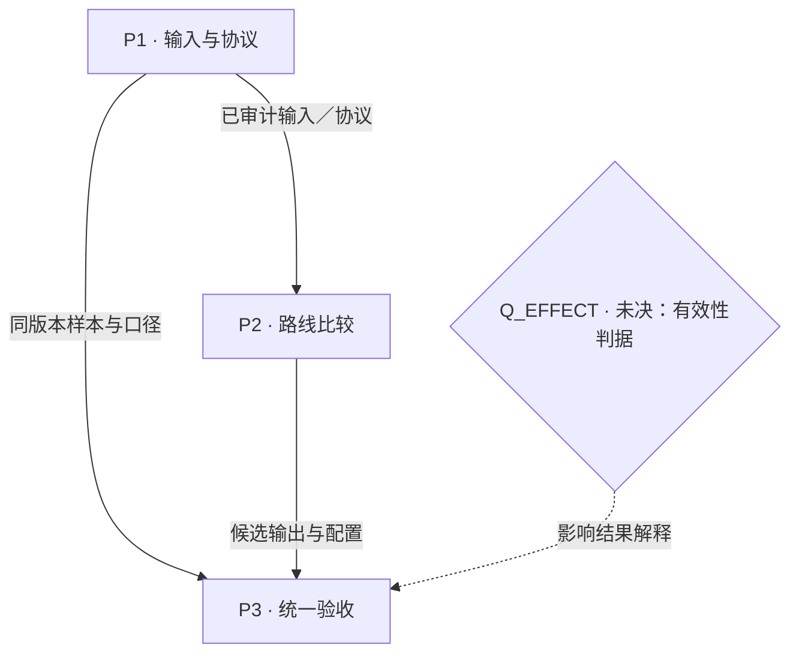
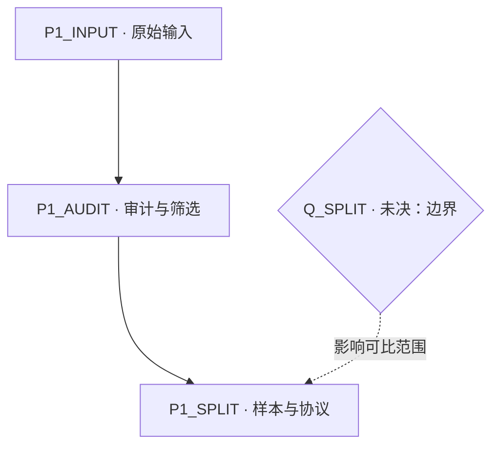

# 规划图：{{项目名称}}

版本：{{版本}}；本轮依据：{{实际输入／资料／结果}}；权威文件：{{路径}}。

> 将 `{{...}}` 换成真实信息；仍缺失的关键内容转为具名 `Q_...` 项。删去不相关字段。保留用户的 part 名称与边界，按真实依赖改画下面的示意；模板本身不代表用户选择。

## 目标与用户给出的 parts

目标与适用范围：{{目标}}。
当前约束与交付要求：{{实际约束；缺失的关键约束写为未决}}。

| ID | 用户给出的 part | 用户的大体规划 | 产物／验收 | 状态及来源 |
| --- | --- | --- | --- | --- |
| P1 | {{名称}} | {{大体规划}} | {{产物及验收，缺口指向 Q}} | {{方案／执行／依据}} |
| P2 | {{名称}} | {{大体规划}} | {{产物及验收}} | {{方案／执行／依据}} |
| P3 | {{名称}} | {{大体规划}} | {{产物及验收}} | {{方案／执行／依据}} |

## 总览

图例：虚线加文字表示未决／暂定关系。替换为具体操作、产物和分支；需要时增加真实并行臂。

## P1 的局部展开

## 节点与决定明细

### P1

- 目的／大体路线：{{用户要求}}。
- 输入 → 操作 → 输出：{{接口、步骤、产物；详情指向子节点}}。
- 验收与对齐时点：{{具体条件／实际约定，缺失则指向未决项}}。
- 方案状态／执行状态／依据：{{分别写明}}。

### P1_INPUT

{{接口、来源、必要形状／单位／可用时刻。}}

### P1_AUDIT

{{操作、筛选规则与依据、审计产物、验收。}}

### P1_SPLIT

{{划分、变换拟合范围、评测范围、决定与依据；未决指向 Q_SPLIT。}}

### P2

{{目的、路线、输入输出、验收、状态及来源。}}

### P3

{{评测与交付口径、关键诊断、证据范围、状态及来源。}}

## 实验分支（实验任务需要时保留）

| ID／所属 part | 问题与假设 | 基线 → 变体 | 固定条件／协议版本 | 观测与预定判据 | 预算／依赖／并行 | 结果去向与证据 |
| --- | --- | --- | --- | --- | --- | --- |
| E_{{名称}}／P2 | {{改变哪个决定}} | {{精确改动}} | {{可比条件}} | {{无依据时指向 Q_EFFECT}} | {{串行前提与可并行臂}} | {{结果去向；真实产物}} |

## 当前未决项

### Q_SPLIT

- 影响节点：P1_SPLIT；沿实际依赖指出其他受影响节点。
- 类型／缺口：{{查证／用户选择／实测；缺什么}}。
- 候选／建议及依据：{{候选后果；建议仍是建议}}。
- 解决动作与负责人／证据来源：{{可执行动作}}。
- 判定与路线变化：{{结果分别怎样改变图}}。
- 复查时点／被阻塞分支：{{局部范围，独立部分继续}}。

### Q_EFFECT

- 影响节点：P3、相关实验分支。
- 类型／缺口：{{有效性口径缺什么}}。
- 候选／建议及依据：{{不能虚构可靠阈值}}。
- 解决动作、判定与路线变化、复查时点：{{待定部分直说}}。

## 有意义的修订

| 版本 | 变更 ID | 改变及依据 | 下游影响／需复核项 | 下一步 |
| --- | --- | --- | --- | --- |
| v1 | {{ID}} | {{真实新增／修改}} | {{影响范围}} | {{最能改变决定的动作}} |
