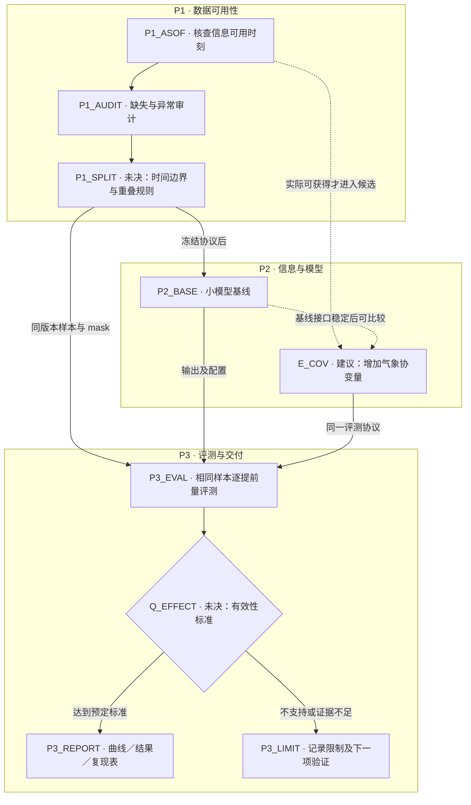
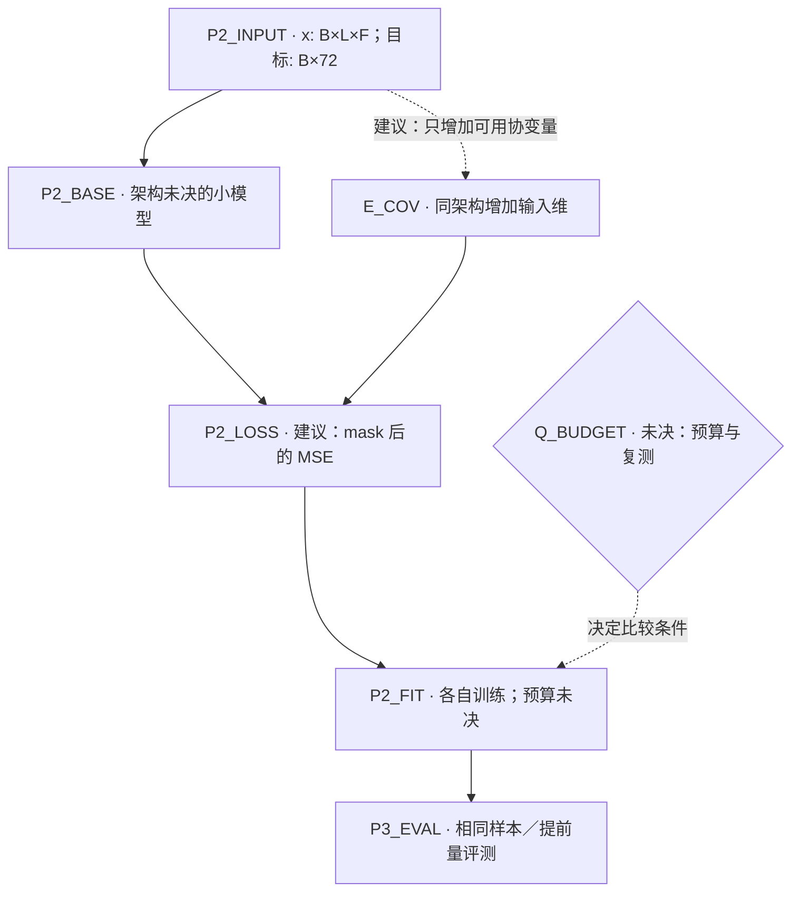

# 示例：由用户划定的风速预测规划

以下是假想输入与输出，所有提案和缺口只属于示例。不要把它导入当前项目或当成已经完成的实验。

内容：

- [总览](#总览)
- [P2 的局部展开](#p2-的局部展开)
- [关键明细](#关键明细)
- [实验记录](#实验记录)
- [当前未决项](#当前未决项)
- [第二轮更新](#示例中的第二轮更新)

假想用户输入：

> 用站点历史观测预测未来 24 小时，每 20 分钟一个点。
> 我定三个 parts：P1 数据可用性——核查缺失、输入可用时刻和时间划分；P2 信息与模型——先有小模型基线，再考虑气象协变量；P3 评测与交付——逐提前量比较，输出曲线和结果表。尚未定具体划分日期、效果阈值、预算和截止时间。

## 总览

## P2 的局部展开

## 关键明细

### P1

用户给出的目的：核查信息与数据协议。执行状态：未开始；依据：假想用户输入。产物为可用信息清单、审计和样本协议。具体节点见 P1_ASOF、P1_AUDIT、P1_SPLIT。

### P1_ASOF

方案状态：用户指定；执行状态：未开始。

列出各输入的观测时刻、发布／可获得时刻、时区、单位与来源。预测起点记为 `t0`，仅使用当时实际可获得的信息。未来气象变量若为事后实测，不能放进预报时输入；历史预报档案能否获取是查证项。验收：每个候选输入都有可核对的可用时刻规则。

### P1_AUDIT

方案状态：用户指定；执行状态：未开始。

统计缺失、异常、重复与来源冲突，再提议筛选／填补规则；规则仍未定。记录规则前后样本覆盖与版本。输入填补与目标缺测分别处理，是否纳入目标和主评测需明确。不得根据预测期风速大小筛掉困难目标而仍宣称完整任务表现。

### P1_SPLIT

方案状态：未决；执行状态：未开始。

沿时间划分训练、验证与持出评测，具体边界、样本起点间隔和窗口重叠规则指向 `Q_SPLIT`。预处理拟合使用训练集合；验证用于候选选择；持出用途在协议中确定。验收：可重建同一批样本并核对跨边界信息。

### P2

用户给出的目的：先小模型基线，再考察额外信息。执行状态：未开始。产物为基线及可比实验臂的配置与预测；是否有效由 P3 的判据决定。

### P2_INPUT

`B` 为 batch，`L` 为历史点数，`F` 为实际可用特征数；`L` 与特征清单未决。未来 24 小时以 20 分钟间隔输出 72 个点；具体起点与端点约定待定。目标、mask 与输出均为 `B×72`，训练／评测用同一单位。

### P2_BASE

小模型基线是用户给出的方向；模型家族、宽度和历史长度未决。先形成可复现基线，再比较候选。材料与小规模实测用于决定，不能在图里假定某模型已经胜出。

### P2_LOSS

方案状态：建议。提案为 `sum(mask * (prediction - target)^2) / sum(mask)`；mask 总和为零的 batch 不执行该损失更新。不要把 masked 元素按整张量尺寸归约。mask 语义依赖 P1；未获选择前保留替代目标。

### P2_FIT

训练预算、候选选择与复测次数指向 Q_BUDGET。只有协议和可比条件确定后，独立臂才可按资源并行；没有实际执行授权与日志，状态保持未开始。

### P3

用户给出的目的：逐提前量比较，交付曲线和结果表。执行状态：未开始。验收口径缺口指向 Q_EFFECT，交付字段与时点指向 Q_DELIVERY。

### P3_EVAL

用户指定逐提前量比较；执行状态：未开始。

建议同时汇报统一有效点上的总体和逐提前量误差，曲线作为诊断。主指标、效果阈值、复测与关键分组指向 `Q_EFFECT`。两臂使用相同样本与 mask，不按每个变体的数据可用性分别选择评测集而直接比较。

### P3_REPORT

用户指定曲线与表。建议表中记录预测起点、目标时刻、提前量、真实值、预测值、mask、单位、数据版本、配置与运行 ID；结果表列协议、随机性、成本与结论范围。列结构、截止时间与对齐节点指向 `Q_DELIVERY`。

### P3_LIMIT

仅按观测记录不支持或证据不足的具体范围、替代解释与下一项可区分验证。保留负结果，不自动重新搜索到满意为止。

## 实验记录

| ID | 问题 | 改动与固定条件 | 依赖／并行安排 | 判据与去向 |
| --- | --- | --- | --- | --- |
| E_COV | 额外信息是否有稳定收益？ | 同模型增加实际可用气象协变量；固定样本、划分、目标、loss、选择与评测协议。输入维变化可能改变参数量，记录这一混杂 | P1 审计与协议冻结、基线接口稳定后，独立臂可按预算并行；绘图不授权运行 | Q_EFFECT 确定后比较；支持则保留，不支持则记录条件，证据不足则继续验证 |

## 当前未决项

| ID／影响对象 | 缺口与类型 | 候选／建议及依据 | 解决动作与复查时点 | 路线变化 |
| --- | --- | --- | --- | --- |
| Q_SPLIT／P1_SPLIT、两实验臂、P3_EVAL | 查证＋选择：日期、覆盖与窗口重叠规则 | 依覆盖统计和任务范围拟定，不能编造日期 | 先审计；生成样本前确定 | 冻结后启用可比实验；变更后旧结果需复核 |
| Q_EFFECT／P3_EVAL、E_COV | 选择＋实测：主指标、实际容忍度、基线噪声 | 基于任务价值和基线噪声确定标准，尚无数值依据 | 查看变体结果前确定；不可确定则保持探索性结论 | 支持／否定／暂不可判断对应不同去向 |
| Q_BUDGET／P2_FIT | 选择：资源、训练预算、复测次数 | 先测小规模成本，按资源拟定，无精确预算依据 | 安排训练前复查 | 决定可并行臂与停止范围 |
| Q_DELIVERY／P3_REPORT | 选择：列结构、验收与时点 | 已有“曲线＋表”，字段候选见明细 | 首轮产物前对齐 | 明确交付，不自动设置提醒 |

## 示例中的第二轮更新

若查证发现气象预报有发布延迟，使某些预测起点拿不到原候选输入：

1. 保留 `P1_ASOF` 的 ID，更新可用时刻规则与实际来源。
2. 将 `E_COV` 的可行性及基于旧输入的结果标为“需复核”，保留旧配置与结果；只复查受影响的 `P1_SPLIT`、`P2_INPUT`、`P3_EVAL` 和比较口径。
3. 新增 `Q_COV_AVAIL`，把“使用上一份当时已发布的预报／不使用该变量”的候选接回图中，说明信息年龄及可比性。
4. 保留不依赖这些输入的历史基线；继续独立的报告格式工作。查证不自动证明某种替代输入最好。
